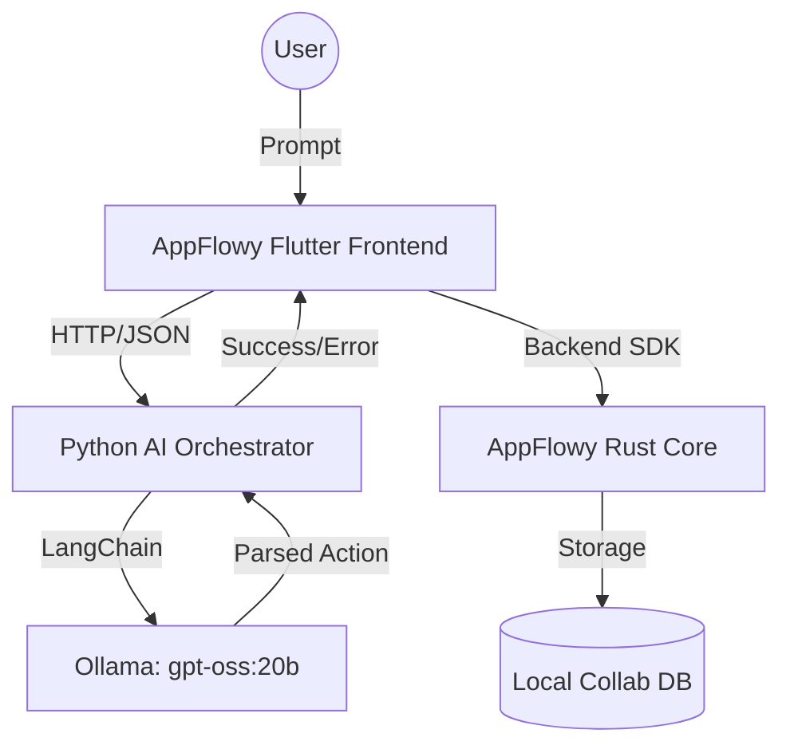

# AppFlowy AI: Intelligent Workspace Orchestration 🚀

Integrating local-first productivity with powerful LLM orchestration. This project embeds an AI Assistant directly into AppFlowy to automate database creation, data structuring, and workspace management.

---

## 🎯 Project Goal
The goal is to create a **seamless AI-to-Workspace bridge** where users can describe their data needs in natural language and have AppFlowy automatically configure the appropriate views, properties, and data structures locally.

### Key Objectives:
- **Local-First AI:** All intelligence runs locally via Ollama, preserving privacy.
- **Automated Structuring:** Intelligent detection of property types (Text, Number, Checkbox, etc.).
- **Clean Workspace:** Automated cleanup of default boilerplate properties.
- **Natural Interaction:** A persistent AI overlay that understands workspace context.

---

## 🏗️ Architecture Stack

The system is built on a decoupled architecture for maximum flexibility and local performance.



### 📦 Components:
- **Frontend (Dart/Flutter):** The user interface hosting the `AiChatOverlay` and `AiAgentClient`.
- **Orchestrator (Python/FastAPI):** A robust agent logic layer using LangChain to parse intent and resolve context.
- **Engine (Rust):** AppFlowy's high-performance core that handles CRDTs and data persistence.

---

## 📈 Progress & Implementation

### Phase 1: AI Chat Integration ✅
- Implemented a non-blocking `AiChatOverlay` widget.
- Created `AiAgentClient` for secure local communication with the orchestrator.

### Phase 2: Database Automation ✅
- **Primary Field Mapping:** Automatically renames the default "Name" field to "ID" for cleaner data modeling.
- **Smart Cleanup:** Automatically deletes default "Type" and "Done" columns upon AI creation.
- **Prop Type Detection:** Real-time detection of data types (e.g., "age" as number, "lead" as text).
- **Duplicate Prevention:** Resolved issues where "name" properties were incorrectly skipped.

### Phase 3: Reliability & Performance ✅
- Improved database name extraction from various prompt formats.
- Migrated to `gpt-oss:20b` for superior reasoning capabilities.
- Created parallel startup orchestration via `start.sh`.

---

## 🚀 Getting Started

### 1. Prerequisites
- **Ollama:** [Download & Install](https://ollama.com/)
- **Model:** Pull the research model used:
  ```bash
  ollama pull gpt-oss:20b
  ```

### 2. Installation
Clone the repository and run the setup:
```bash
# Install Python dependencies
python3 -m venv venv
source venv/bin/activate
pip install -r agent/requirements.txt

# Fetch Flutter dependencies
cd appflowy/frontend/appflowy_flutter
flutter pub get
```

### 3. Execution
Launch both the AI service and the AppFlowy application with a single command:
```bash
./start.sh
```

---

## 🛠️ Project Structure

| Directory | Description |
| :--- | :--- |
| `agent/` | Python FastAPI Orchestrator & LLM Logic |
| `appflowy/` | Core AppFlowy source code (Rust + Flutter) |
| `appflowy_flutter/` | Main frontend application |
| `lib/ai/` | Dart implementation of AI Agent client and handlers |

---

> [!TIP]
> **Try this prompt:** "Create a CRM database with name, company, email, and deal_value properties."
> The AI will automatically set `deal_value` to a Number type and `name` as a Text property while setting the primary field to `ID`.

---
*Built with ❤️ for the Open Source Community.*
